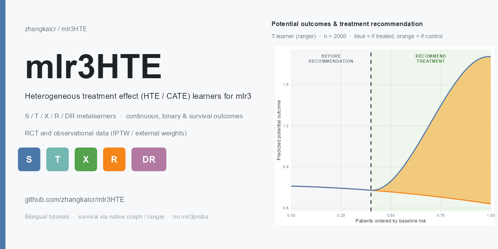

<p align="center">
  
</p>

# mlr3HTE <a href="https://zhangkaicr.github.io/mlr3HTE/"></a>

<p>
  <a href="https://github.com/zhangkaicr/mlr3HTE/actions/workflows/R-CMD-check.yaml"></a>
  <a href="https://zhangkaicr.github.io/mlr3HTE/"></a>
  
  
</p>

> **仓库**：<https://github.com/zhangkaicr/mlr3HTE>
> **双语教程站（含搜索 / 中英切换 / 明暗主题）**：<https://zhangkaicr.github.io/mlr3HTE/>

`mlr3HTE` 是一个基于 **mlr3** 的异质性治疗效应（HTE / CATE）估计包，把课程模块三里的
S- / T- / X- / R- / DR-learner 做成了正规可安装的 mlr3 学习器。

**覆盖范围**

| 维度 | 支持 |
|---|---|
| 结局类型 | 连续（均值差）、二分类（风险差）、生存（t0 时点生存概率差） |
| 数据类型 | 随机化试验（RCT）、观察性数据（IPTW 或外部权重） |
| metalearner | S、T、X、R、DR 五种 |
| 接口 | 函数式 API + mlr3 R6 Learner（可进 `resample` / `benchmark` / `tune`） |

引擎只有一套：五种 metalearner 的公式与结局类型无关，它们统一通过「结局模型」打交道——
`predict(newX)` 对连续结局返回 `E[Y|X]`、对二分类返回 `P(Y=1|X)`、对生存返回 `S(t0|X)`。

> **为什么基于 mlr3？——基学习器想换就换。**
> 五种 metalearner 只是「配方」，真正干活的是基学习器。因为 `metalearner()` 直接吃 `lrn()` 对象，
> **把随机森林换成 XGBoost、GLMnet、kNN、SVM……只是一行 `learner_base = lrn("regr.xgboost")` 的事**，
> 其余代码、接口、工作流原样不动：
>
> ```r
> fit <- metalearner("T", X, A, Y, learner_base = lrn("regr.ranger"))   # 随机森林
> fit <- metalearner("T", X, A, Y, learner_base = lrn("regr.xgboost"))  # XGBoost
> fit <- metalearner("T", X, A, Y, learner_base = lrn("regr.glmnet"))   # Lasso
> fit <- metalearner("T", X, A, Y, learner_base = lrn("regr.lm"))       # 线性回归
> ```
>
> mlr3 自带的全套 learner（`ranger` / `xgboost` / `glmnet` / `kknn` / `svm` / `nnet` / `rpart` / `lm` …）
> 与调参、重采样、基准对比工作流（`tune` / `resample` / `benchmark`）也一并免费继承。
> 这正是用 mlr3 体系而非自写训练管道的核心收益——详见教程「[换基学习器：mlr3 生态随便挑](https://zhangkaicr.github.io/mlr3HTE/#/tutorial)」。

---

## 1 安装与加载

从 GitHub 安装（推荐 `pak`，会自动解析并装齐全部依赖；`remotes` 也行）：

```r
# 方式一：pak（依赖求解快、并行下载，推荐）
pak::pak("zhangkaicr/mlr3HTE")

# 方式二：remotes
remotes::install_github("zhangkaicr/mlr3HTE")
```

开发期也可直接加载源码：

```r
pkgload::load_all(".")      # 开发期
# 或安装后
library(mlr3HTE)
```

> **`lrn()` 已经能从 `mlr3HTE` 直接用**——本包把 `mlr3::lrn()` 再导出了，
> 所以下面所有示例只需 `library(mlr3HTE)` 一行，不用再 `library(mlr3)`。
> 但 `resample()` / `benchmark()` / `rsmp()` 这些 mlr3 工作流函数没有再导出，
> 走 R6 Learner 那条路时要自己加 `library(mlr3)`。

依赖（均已列入 `DESCRIPTION` 的 `Imports`，安装时自动装齐，无需手动补）：
`mlr3`、`mlr3learners`、`paradox`、`R6`、`survival`、`ranger`、`dplyr`、`cli`。
其中 **`ranger` 是必需依赖**——包的默认基学习器就是 `regr.ranger`，且所有教程都用到它
（早期文档称“ranger 可选”已更正）。`testthat` 在 `Suggests`，仅运行测试时需要。

> **生存分支完全不依赖 mlr3proba。** 基学习器用字符串指定：`"coxph"`
> （默认，`survival::coxph`）或 `"ranger"`（`ranger` 包已随 `Imports` 安装）。
> 传 `lrn("surv.*")` 会被明确拒绝并提示——那需要 mlr3proba，本包不引入这个依赖。

---

## 2 函数式 API

### 2.1 连续结局（RCT）

```r
set.seed(1)
d <- mlr3HTE_demo_data(n = 4000)

fit <- metalearner("T", d$X, d$A, d$Y,
                   learner_base = lrn("regr.ranger", num.trees = 300, seed = 1))
fit$ate            # ATE 估计
fit$cate_train     # 训练集上每个人的 CATE
fit$predict(d$X)   # 新数据上的 CATE
```

### 2.2 二分类结局（风险差尺度）

```r
db <- mlr3HTE_demo_binary(n = 4000)

fit <- metalearner("T", db$X, db$A, db$Y,
                   learner_base = lrn("classif.ranger", num.trees = 300, seed = 1))
fit$ate            # 平均风险差
```

### 2.3 生存结局（t0 时点生存概率差）

```r
ds <- mlr3HTE_demo_surv(n = 4000, t0 = 2)

fit <- metalearner("T", ds$X, ds$A, ds$Y,
                   learner_base = "coxph",   # 或 "ranger"，均为原生实现
                   t0 = 2)
fit$ate            # 平均 S1(2) - S0(2)
```

`t0` 缺省时取事件时间中位数。删失由两部分处理：S/T 的生存模型自身已在似然中正确处理；
X/R/DR 需要个体尺度结局（用 `I(T > t0)`），此时会乘上删失 IPCW 权重。

生存结局有两套引擎（`engine` 参数，默认 `"native"`，行为零变化）：

```r
# 引擎二：survlearners（GitHub 包，需先安装；只支持 S/T/X/R 与 S(t0) 差）
remotes::install_github("som-shahlab/survlearners", subdir = "r-package/survlearners")
fit <- metalearner("X", ds$X, ds$A, ds$Y, learner_base = "grf",
                   t0 = 2, engine = "survlearners")
```

| | `"native"`（默认） | `"survlearners"` |
|---|---|---|
| metalearner | S/T/X/R/DR 五族 | S/T/X/R（无 DR） |
| 效应尺度 | S(t0) 差 + RMST 差 | 仅 S(t0) 差 |
| 基学习器 | `"coxph"`/`"ranger"` + 任意 mlr3 learner | `"coxph"`/`"grf"`/`"lasso"`（`"ranger"` 是 grf 别名） |
| 依赖 | 零额外 | 需装 survlearners（已列入 Suggests） |

注意 survlearners 的 `T-coxph` 组合实测有系统性偏差（把未中心化的基线累积危险与
中心化的 `predict(type="risk")` 相乘），详见教程 09；要 Cox 做 T-learner 请用原生引擎。

### 2.4 观察性数据

```r
do <- mlr3HTE_demo_obs(n = 4000)

# 方式一：内部训倾向得分做 IPTW
fit <- metalearner("X", do$X, do$A, do$Y,
                   learner_base = lrn("regr.ranger"),
                   weighting = "iptw", stabilize = TRUE)

# 方式二：用自己算好的权重
fit <- metalearner("DR", do$X, do$A, do$Y, weighting = "external",
                   weights = my_weights)
```

### 2.5 便捷封装

`*_learner()` 系列与课程脚本同款签名，直接返回训练集 CATE 向量：

```r
s_learner(X, A, Y, learner_base = lrn("regr.ranger"))
t_learner(X, A, Y, learner_base = lrn("regr.ranger"))
x_learner(...); r_learner(...); dr_learner(...)
```

---

## 3 R6 Learner（接入 mlr3 工作流）

用 `ml_task()` 把原始数据编码成 Task，再交给 `lrn("regr.metalearner")`：

```r
task <- ml_task(d$X, d$A, d$Y)                  # 连续/二分类/生存通吃
l    <- lrn("regr.metalearner", metalearner = "T")
l$learner_base <- lrn("regr.ranger", num.trees = 300, seed = 1)

l$train(task)
l$predict(task)$response                       # CATE

# 接入 mlr3 工作流
resample(task, l, rsmp("cv", folds = 5))
benchmark(benchmark_grid(task,
           list(lrn("regr.metalearner", id = "T", metalearner = "T"),
                lrn("regr.metalearner", id = "X", metalearner = "X")),
           rsmp("cv", folds = 5)))
```

`ml_task()` 的编码约定（因为 mlr3 的 Task 目标列装不下 `Surv` 对象）：

| 结局 | 目标列 `.outcome` | 附带列 |
|---|---|---|
| 连续 / 二分类 | `Y`（二分类取 0/1） | — |
| 生存 | 随访时间 | `.status` = 事件指示 |

结局类型、状态列名与 `t0` 记录在 `task$extra_args` 里。该字段经实测在
`clone(deep = TRUE)$filter()` 与 `serialize()/unserialize()` 之后都保留，
所以 `resample()` 分折时元数据不会丢。

**可调字段**（不是 param，因为 paradox 的 `p_uty` 存不下 Learner 对象）：

| 字段 | 说明 |
|---|---|
| `learner_base` | 结局模型基学习器，类型须与结局匹配 |
| `learner_tau` | 效应阶段回归学习器；`NULL` 时用引擎的正则化默认值 |
| `learner_ps` | 倾向得分学习器（IPTW 时用，默认 `classif.log_reg`） |
| `treatment_col` | 处理列名，默认 `"A"` |
| `t0` | 生存效应时点 |
| `stabilize` | IPTW 是否用稳定化权重 |

**可调参数**（`param_set`，可用于 `tune()`）：`metalearner`（S/T/X/R/DR）、
`weighting`（none/iptw/external）。

---

## 4 方法学要点

| Learner | 公式 | 备注 |
|---|---|---|
| S | 一个结局模型含 `A`，反事实预测相减 | 最省数据，但基学习器若不建模交互则 CATE 近常数 |
| T | 两组各拟合一个结局模型，预测相减 | 简单稳健；两组样本量减半 |
| X | 插补个体效应后按 `g(X)` 融合 | 两组样本不均时表现好（Künzel et al. 2019） |
| R | Robinson 残差化 `(Y - m(X))/(A - e(X))`，以 `(A-e)^2` 加权回归 | Nie & Wager 2021 |
| DR | 伪结果 `psi = m1 - m0 + A(Y-m1)/e - (1-A)(Y-m0)/(1-e)` 后回归 | 双重稳健（Kennedy 2020） |

**关于 `learner_tau` 的默认值**：X/R/DR 的第二阶段是对**伪结果**做回归，噪声结构与
结局模型完全不同（R/DR 的目标含 `1/(A-e)` 放大）。ranger 回归默认
`min.node.size = 5`，树会长得很深、把伪结果里的噪声也拟合进去——实测会让 R/DR 的
CATE 相关从 0.9 掉到 0.2。因此引擎在 `learner_tau = NULL` 时**不沿用** `learner_base`，
而是单独建一个 `min.node.size = 50` 的 ranger。需要更强的灵活性可自行覆盖；
在生存 R/DR 上，`learner_tau = lrn("regr.lm")` 往往更好（伪结果噪声大、真值近线性时，
线性模型更稳）。

**已知局限**

- 生存 R/DR 的 CATE 是二阶段回归的结果，**不受 `[-1, 1]` 概率尺度约束**，个别点可能越界；
  S/T 的 CATE 是两个生存概率之差，严格有界。
- 权重通过**重要性重采样**落地（mlr3 1.8 的 Task/Learner 没有 case weights API），
  会引入蒙特卡洛噪声，需要复现结果时请在调用前 `set.seed()`。
- 生存分支默认 `coxph` 是线性预测结构，S-learner 因此难以捕捉异质性（T/X 不受此限）。

---

## 5 脚本与文件

```
R/
  aaa.R            .onLoad 注册 + .metalearner_registry 模型登记处
  survival_base.R  原生生存基学习器（coxph/ranger）+ 删失 IPCW
  engine.R         引擎：结局模型抽象 + 五种 metalearner + 调度器
  api.R            函数式 API + ml_task() + 4 个演示数据集
  learner.R        R6 Learner lrn("regr.metalearner")
smoke_test.R       连续结局 RCT 冒烟测试
smoke_test2.R      二分类/生存/观察性冒烟测试
smoke_test3.R      R6 Learner 三类结局 + resample 冒烟测试
tests/testthat/   119 个测试
```

演示数据集（`*_obs_*` 为观察性版本，含真实 PS）：

| 函数 | 结局 | 数据 | 真值随数据返回 |
|---|---|---|---|
| `mlr3HTE_demo_data()` | 连续 | RCT | `tau`, `ate` |
| `mlr3HTE_demo_binary()` | 二分类 | RCT | `tau`, `ate` |
| `mlr3HTE_demo_surv()` | 生存 | RCT | `tau`, `ate`, `t0` |
| `mlr3HTE_demo_obs()` | 连续 | 观察性 | `tau`, `ate`, `ps_true` |
| `mlr3HTE_demo_obs_binary()` | 二分类 | 观察性 | `tau`, `ate`, `ps_true` |
| `mlr3HTE_demo_obs_surv()` | 生存 | 观察性 | `tau`, `ate`, `ps_true` |

每个都返回真实的 `tau`，方便直接对账——这是教学时最有用的部分。

## 5.5 配套教程

**在线双语文档站**：<https://zhangkaicr.github.io/mlr3HTE/>
（全局搜索、中英切换、明暗主题；内容与本 README 同步）

`tutorial/` 下是完整教程，覆盖**三类结局 × 随机/观察性**共 6 种组合：

- `tutorial/00_教程.md` — 主文档：统一架构、6 格矩阵、五种 learner 公式与选用、
  调参避坑（含目录与对照表）
- `tutorial/code/01..08_*.R` — 8 个配套脚本，每个自带章节目录，可独立运行

运行方式（在 `mlr3HTE/` 目录下）：

```r
Rscript tutorial/code/01_连续结局_随机化RCT.R
```

| 脚本 | 内容 |
|---|---|
| `01_连续结局_随机化RCT.R` | 连续 + RCT，五种 learner 对账 |
| `02_连续结局_观察性研究.R` | 连续 + 观察性，IPTW vs 未调整 |
| `03_二分类结局_随机化RCT.R` | 二分类 + RCT，风险差尺度 |
| `04_二分类结局_观察性研究.R` | 二分类 + 观察性 |
| `05_生存结局_随机化RCT.R` | 生存 + RCT，t0 生存概率差 |
| `06_生存结局_观察性研究.R` | 生存 + 观察性，IPTW × IPCW |
| `07_五种metalearner横向对比.R` | 三种结局 × 五种 learner 对比表 |
| `08_mlr3工作流集成.R` | `ml_task` + `resample` + `benchmark` |
| `09_生存结局_survlearners引擎.R` | 生存第二套引擎 `engine = "survlearners"`，与原生引擎同题对比 |
| `10_HTE评价指标.R` | Qini / c-for-benefit / TOC：模型判别力评价，附随机排序对照 |
| `11_评价指标真值对账.R` | 用已知真 `tau` 当标尺：误差拆成排序损失与估计噪声，c-for-benefit 闭式上界 |
| `12_三类结局评价指标.R` | 三个指标在连续 / 二分类 / 生存上各跑一遍；生存要 IPCW，并演示「先拟合后切分」的泄漏 |
| `13_换基学习器_基准对比.R` | **用 mlr3 体系的核心收益**：基学习器一行互换（ranger / xgboost / glmnet / rpart / lm），并复用 `benchmark()` 横向比 |

---

## 6 依赖与运行环境

复现本仓库全部教程与测试结果所需的**依赖包版本**与**测试环境**细节如下（版本均为 2026-10-21 抓取的当前测试环境真实取值）。

### 6.1 测试环境

| 项目 | 取值 |
|---|---|
| R 版本 | 4.5.1 (2025-06-13 ucrt) |
| 平台 | x86_64-w64-mingw32/x64 |
| 操作系统 | Windows 11 x64 (build 26200) |
| 语言环境 | 需 `en_US.UTF-8`（LC_CTYPE）——R 在 `LC_CTYPE=C` 下解析含 UTF-8 字节的源码会改写字符串常量，本项目实测有此坑 |
| 测试命令 | `Rscript -e 'Sys.setlocale("LC_CTYPE","en_US.UTF-8"); pkgload::load_all("."); testthat::test_local()'` |
| 测试规模 | 8 个测试文件 / 58 个 `test_that` 块 / 293 个期望，全部通过 |
| 持续集成 | GitHub Actions `R-CMD-check.yaml`，运行于 `ubuntu-latest` |

### 6.2 直接依赖（DESCRIPTION · Imports）

安装 mlr3HTE 时由 `pak` / `remotes` 自动解析装齐，无需手动补。

| 包 | 版本 | 角色 |
|---|---|---|
| `mlr3` | 1.8.0 | 核心框架：Task / Learner / resample / benchmark |
| `mlr3learners` | 0.16.0 | 基学习器注册表（ranger、xgboost、glmnet、lm…） |
| `paradox` | 1.0.1 | 参数空间与调参（tune） |
| `R6` | 2.6.1 | 面向对象（Learner 子类） |
| `survival` | 3.8-3 | 生存分析基础（coxph、survfit） |
| `ranger` | 0.18.0 | 默认基学习器（随机森林，含生存分支） |
| `dplyr` | 1.2.1 | 数据整理 |
| `cli` | 3.6.6 | 运行信息与告警 |
| `ggplot2` | 4.0.3 | 结果可视化 |

### 6.3 建议依赖（DESCRIPTION · Suggests）

仅运行测试、绘图或教程演示时需要。

| 包 | 版本 | 角色 |
|---|---|---|
| `testthat` | 3.3.2 | 单元测试（8 文件 / 58 块 / 293 期望） |
| `patchwork` | 1.3.2 | 多图拼接 |
| `ggdag` | 0.2.13 | DAG 绘图（教程示意图） |
| `survlearners` | 0.0.1 | 生存 learner 演示（可选） |
| `rcmdcheck` | （CI 提供） | R CMD check；当前环境未安装，由 GitHub Actions 提供 |

### 6.4 完整递归依赖清单（89 个）

<details>
<summary>展开全部 89 个包（pkg@version）</summary>

- MASS@7.3-65
- Matrix@1.7-3
- MatrixModels@0.5-4
- R6@2.6.1
- Rcpp@1.1.2
- Rdpack@2.6.6
- S7@0.2.2
- askpass@1.2.1
- backports@1.5.1
- base64enc@0.1-6
- brio@1.1.5
- bslib@0.11.0
- cachem@1.1.0
- callr@3.7.6
- checkmate@2.3.4
- class@7.3-23
- cli@3.6.6
- colorspace@2.1-4
- covr@3.6.5
- curl@7.1.0
- data.table@1.18.4
- desc@1.4.3
- diffobj@0.3.9
- digest@0.6.39
- dplyr@1.2.1
- evaluate@1.0.5
- farver@2.1.2
- fastmap@1.2.0
- fontawesome@0.5.3
- forcats@1.0.1
- future@1.76.0
- future.apply@1.20.2
- generics@0.1.4
- ggdag@0.2.13
- ggforce@0.5.0
- ggplot2@4.0.3
- ggraph@2.2.2
- glue@1.8.1
- gridExtra@2.3
- gtable@0.3.6
- highr@0.12
- htmltools@0.5.9
- igraph@2.3.4
- isoband@0.3.0
- jquerylib@0.1.4
- jsonlite@2.0.0
- labeling@0.4.3
- lgr@0.5.2
- lifecycle@1.0.5
- magrittr@2.0.5
- memoise@2.0.1
- mgcv@1.9-3
- mlr3@1.8.0
- mlr3learners@0.16.0
- mlr3measures@1.3.0
- mlr3misc@0.23.0
- nlme@3.1-168
- nnet@7.3-20
- paradox@1.0.1
- patchwork@1.3.2
- pillar@1.11.1
- pkgload@1.5.3
- polyclip@1.10-7
- praise@1.0.0
- prettyunits@1.2.0
- processx@3.9.0
- ps@1.9.3
- purrr@1.2.2
- ranger@0.18.0
- rbibutils@2.4.1
- rematch2@2.1.2
- sass@0.4.10
- scales@1.4.0
- splines@4.5.1
- stringi@1.8.7
- stringr@1.6.0
- survival@3.8-3
- survlearners@0.0.1
- sys@3.4.3
- testthat@3.3.2
- tibble@3.3.1
- tidygraph@1.3.1
- uuid@1.2-2
- vctrs@0.7.3
- waldo@0.6.2
- withr@3.0.2
- xfun@0.57
- xml2@1.5.2
- yaml@2.3.12

</details>

### 6.5 复现与版本锁定

- **版本锁定**：仓库根目录的 `renv.lock` 记录了全部依赖的精确版本；先 `renv::restore()` 再 `pkgload::load_all('.')` 即可回到本节所列环境。
- **实时核对**：在 R 里运行 `sessionInfo()` 可打印当前加载的全部包版本。
- **生存分支无 `mlr3proba` 依赖**：基学习器用字符串 `"coxph"` / `"ranger"` 指定，不引入额外包。

### 6.6 版本号规则：每次推送 +0.01

版本号是**两位小数的批次计数**，不是语义化三段式：`0.20` → `0.21` → `0.22` → …，
每推送一次更新就加 `0.01`（功能、修复、纯文档一视同仁）。

发布一个批次时，四处必须同步：

| 位置 | 内容 |
|---|---|
| `DESCRIPTION` | `Version: 0.22` |
| `CHANGELOG.md` | 顶部新增 `## [0.22]` 小节 |
| `docs/assets/js/content-home.js` | `SITE_META.version`（页脚读它） |
| `docs/assets/js/content-changelog.js` | `lede` 的「当前版本」与当前小节 `heading` |

前两处的机器部分交给脚本，后两处的文字仍要人写：

```r
# 在包根目录执行：改 DESCRIPTION 与 SITE_META，并列出还引用旧版本号的文件
Rscript dev/bump_version.R 0.22
```

`tests/testthat/test-version.R` 会断言 `DESCRIPTION` 与 `SITE_META.version` 一致、
更新日志页中英 lede 都标了当前版本——版本号再漂移，CI 直接红。

